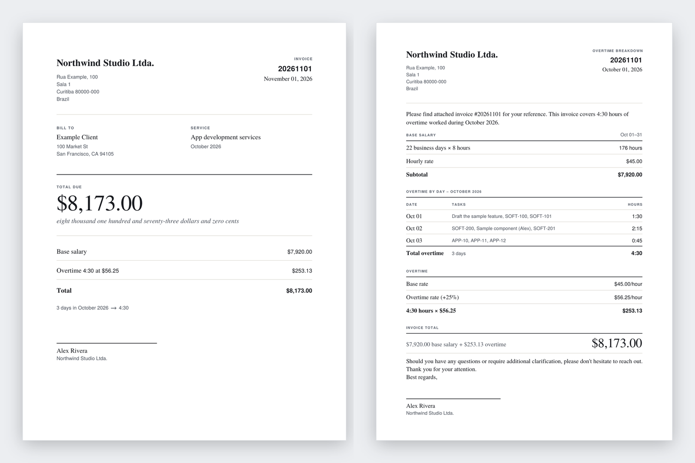

# Overtime invoice

A local page for a monthly contractor invoice. You fill in a profile, paste the month's overtime notes, and get three things:

- an invoice PDF
- an overtime breakdown PDF
- the email that sends them

## What it makes

These are the files for the fictional company in [`examples/`](examples): Northwind Studio billing Example Client for October 2026, with three days of overtime.



Open the real files: [invoice PDF](docs/example-invoice.pdf) · [overtime breakdown PDF](docs/example-overtime-breakdown.pdf)

<details>
<summary>And the email that sends them</summary>

```text
Dear Jordan,

I hope you're doing well.

Please find attached Invoice #20261101 for October 2026, along with the Overtime Breakdown document detailing all overtime hours and the corresponding tasks completed during the month.

Invoice Summary
Base salary: $7,920.00
Overtime: $253.13 (4:30 hours)
Total invoice amount: $8,173.00

If you have any questions or need any additional information, please don't hesitate to reach out.

Thank you for your time and support.

Best regards,

Alex Rivera
Northwind Studio
```

</details>

To make these yourself, run `npm run generate -- --profile examples/sample-profile.json --input examples/sample-month.txt --year 2026 --out ./out`.

## Your data stays here

Nothing is uploaded. The profile and the notes stay in this browser. A finished profile is kept in a list there: next month, pick it and change the notes. Downloading the files saves a profile that is not in the list yet, and you can delete one you no longer need. You can export the profile as JSON and import it on another computer.

## Run it

```bash
npm install
npm test
npm run dev
```

Open the address Vite prints. Load the example to see a fictional month, then replace it with your own company, client, rate, and notes.

The same generator can write the files from the command line:

```bash
npm run generate -- --profile profile.json --input month.txt --year 2026 --out ./out
```

`profile.json` is the file you export from the page. `month.txt` is the pasted notes. `--year` can be left out when the notes write the year (`01/10/2026`, `2026-10-01`). The invoice is dated today unless you pass `--date 2026-11-05`, and `--number INV-042` replaces the usual number.

## Notes format

Write one day per line, the way you already do. Each line needs a date and the time worked; whatever is left is the task list.

```text
Horas Extras dia 01/10 - Total 1:30 SOFT 100 101
02/10 1h30 Fixed the login SOFT-102
2026-10-03 90min PLA-7
Oct 6: 18:00-20:30 APP 1 2
7 de outubro — 2 horas e 15 minutos — SOFT 201
08/10/2026,1.5,"SOFT-301, SOFT-302"
```

| | Understood |
|---|---|
| Dates | `01/10`, `1/10/2026`, `01.10`, `2026-10-01`, `Oct 1`, `October 1st, 2026`, `1 de outubro`, with or without a weekday (`Mon`, `seg`) |
| Time | `1:30`, `1h30`, `1h 30m`, `1.5h`, `1,5 horas`, `90 min`, `2 horas e 15 minutos`, `01:30:00`, and ranges such as `18:00-20:30` (several ranges on a line are added up) |
| Layout | Slack messages, plain lines, bullets, and rows pasted from a spreadsheet (commas or tabs). A header row and a closing `Total` line are skipped. |

- **Day/month or month/day.** A number above 12 settles it (`23/10` or `10/23`). Otherwise the reading that puts every day in one month wins, and then the month you picked. The page says which way it read the dates.
- **A line without a date** continues the day above it, so a task list that runs onto a second line stays with its day.
- **The same day twice** is added up (two sessions). An identical line pasted twice is an error, so nothing is counted double.
- If the line says `Total`, the time after it wins over any other time on the line.

Tasks: an uppercase project code applies to the bare numbers that follow it, until another project code appears. `SOFT 100` becomes `SOFT-100`. `PLA-400` stays as it is. Words stay as a description, in the order you wrote them. A parenthetical stays on the item before it: `PLA 500 (Sample note)`. A code repeated on the same day is kept once. Names, timestamps, `(edited)`, and `Sent using @…` are ignored.

## Invoice date and number

The invoice is dated the day you make it. Its number starts as the 1st of the month after the one worked, so October 2026 is `20261101`. Both are fields on the page: change the date to prepare an invoice now and send it later, or type your own number. A changed number goes back to the usual one when you pick another month.

## How the total is calculated

Weekdays in the month are the business days. Holidays that fall on a weekday still count.

- Base salary = business days × hours in a day × hourly rate
- Overtime rate = hourly rate × (1 + overtime percent)
- Overtime pay is rounded to the nearest cent
- The invoice total drops the remaining cents, so the amount is a whole dollar and the words end in "zero cents"

At $45 an hour and 25% overtime, the example month is the check: 4:30 of overtime is $253.13, the base salary is $7,920.00, and the invoice is $8,173.00.

The PDFs follow the letter shown on the page: the same layout, colors and type hierarchy. The invoice is US Letter and the breakdown is A4. They use Times and Helvetica, the fonts built into every PDF reader, in place of the page's IBM Plex Serif and Sans, so the project ships no font files.

The page does not create a tax receipt (NFS-e).
